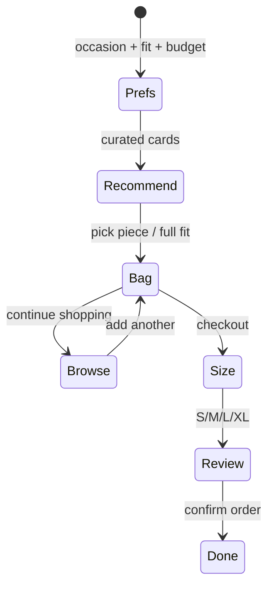

# Vela · Shop with Lumi

A premium contemporary apparel storefront and AI shopping buddy for **Vela**, powered by **Lumi**.

Built with **LangGraph StateGraph**, **FastAPI**, and a polished vanilla JS frontend — mint-green and lavender UI inspired by clean product experiences (Krisp / Atlassian density).

Ranking uses a **local GloVe-style embedding** (`src/local_glove.py`) — tiny domain word vectors + cosine similarity over the catalog. No TensorFlow, no cloud LLM required.

**Tagline:** Shop smarter. Love what you find.

---

## Frontend features

* Soft mint page (`#DDF7E4`), lavender product cards, high-contrast charcoal text
* Floating **Lumi** chat widget with avatar, online status, chips, and product rails
* Catalog browsing (home / shop / bag), product modal, FAQ shortcuts
* Recommendation cards with View / Add to cart / Continue shopping
* 15-minute priority hold timer during conversational checkout
* Responsive layout with FAQ access on mobile

---

## Architecture



---

## Project structure

```
AI BOT/
├── data/catalog.json
├── src/
│   ├── agent.py
│   ├── catalog_service.py
│   ├── local_glove.py      # offline semantic matching
│   ├── graph.py
│   ├── guardrails.py
│   └── models.py
├── static/
│   ├── css/style.css
│   ├── js/app.js
│   └── index.html
├── tests/
├── app.py                 # FastAPI + Vercel entrypoint
├── cli.py                 # optional terminal chat
├── vercel.json
├── pyproject.toml
└── requirements.txt
```

---

## Quickstart

```bash
python -m pip install -r requirements.txt
python app.py
```

Open [http://127.0.0.1:8000](http://127.0.0.1:8000).

Optional CLI:

```bash
python cli.py
```

Tests:

```bash
python tests/test_flow.py
python tests/test_faq.py
python tests/test_api.py
python tests/test_cart_guardrails.py
python tests/test_out_of_catalogue.py
python tests/test_piece_selection.py
```

---

## Deploy to Vercel

This app is FastAPI (`app.py`). Vercel runs it as a Python serverless function.

### 1. One-time setup

```bash
npm i -g vercel          # if needed
cd "/path/to/AI BOT"
vercel login
```

### 2. Deploy

Preview:

```bash
vercel
```

Production:

```bash
vercel --prod
```

Or connect the GitHub repo in the [Vercel dashboard](https://vercel.com/new) — every push deploys automatically.

### 3. What was configured

| File | Purpose |
|------|---------|
| `vercel.json` | Function timeout + exclude tests/venv from the bundle |
| `pyproject.toml` | `[tool.vercel] entrypoint = "app:app"` |
| `.vercelignore` | Skip `.venv`, tests, caches |

No env vars required for the current rule-based + local GloVe setup.

### Caveats on serverless

* **Chat memory** uses in-process LangGraph `MemorySaver`. On Vercel, cold starts / multiple instances can drop mid-chat state. Fine for demos; for production use a shared checkpointer (Redis / Postgres).
* **Bundle size**: `langchain` + `langgraph` are heavy. If the deploy fails on size limits, trim unused deps or switch the API host to Railway / Render / Fly.io (better fit for a long-lived Python process).
* Local CLI is now `cli.py` (renamed from `main.py` so Vercel doesn’t pick the wrong entrypoint).